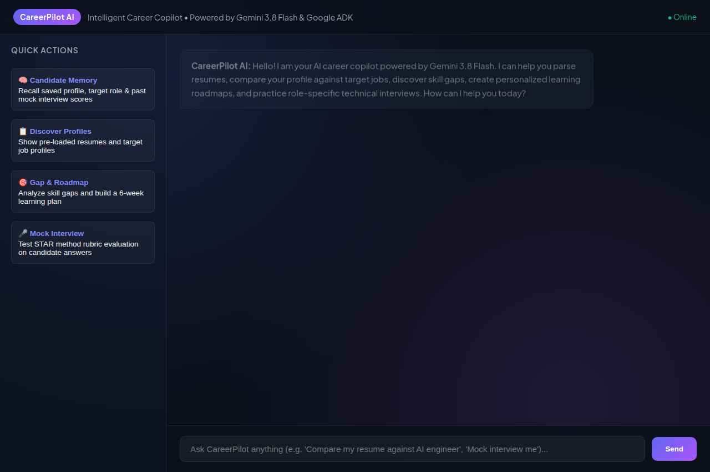
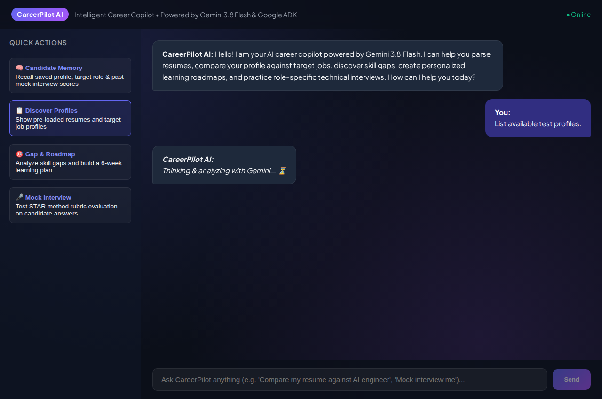
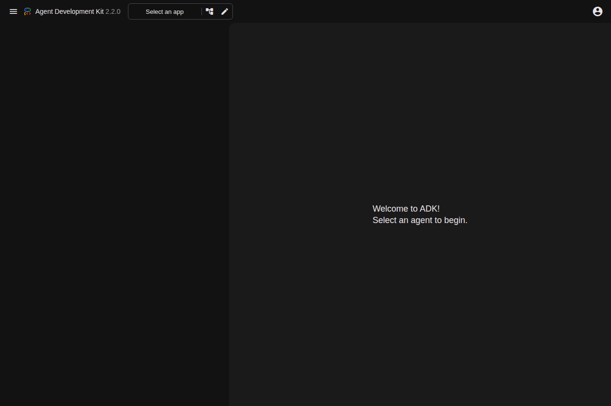

# CareerPilot AI — An AI Career Assistant

> Built with Google Agent Development Kit (ADK) and Gemini 3.8 Flash for the Google Cloud *Build with Gemini* workshop.

---

## 🌟 Executive Summary & Motivation

In today's fast-evolving technology landscape, job seekers and career pivoters frequently face challenges:
- Assessing whether their background genuinely matches modern job descriptions.
- Translating missing skills into concrete, actionable study plans.
- Receiving objective, rubric-driven feedback on practice interview questions.

**CareerPilot AI** is an intelligent, agent-first copilot that bridges these gaps. It provides deterministic resume parsing, automated job-fit gap analysis, structured learning roadmaps with capstone project recommendations, role-specific interview coaching using the STAR framework, cross-turn candidate preference memory, A2UI visual cards, and Firestore cloud persistence.

---

## 📸 Website & Application Previews

### 1. Modern Glassmorphic Web Application (`http://localhost:8081`)
Features one-click quick actions for candidate memory, resume gap analytics, customized roadmaps, and STAR interview evaluations.



### 2. Live AI Answers & Candidate Memory in Action
Demonstrates multi-turn memory recall, target profile retrieval, and structured career recommendations generated by the agent.



### 3. Google ADK Developer Playground (`http://localhost:8080`)
Interactive developer environment rendering agent reasoning, A2UI card layouts, tool calls, and Vertex AI Memory Bank durable fact extraction.



---

## 🏗️ Architecture & How It Works

```
                     +----------------------------------------+
                     |         User / Candidate Input        |
                     +----------------------------------------+
                                         |
                                         v
                     +----------------------------------------+
                     |         Google ADK Agent Engine        |
                     |       (Gemini 3.8 Flash Model)         |
                     +----------------------------------------+
                                         |
        +-------------------+------------+------------+--------------------+
        |                   |                         |                    |
        v                   v                         v                    v
+----------------+  +----------------+        +----------------+  +------------------+
| Profile Memory |  | Resume Parsing |        | Gap & Roadmap  |  | Mock Interview   |
|   & Goals      |  | & Extraction   |        |   Engine       |  | Coaching & STAR  |
+----------------+  +----------------+        +----------------+  +------------------+
        |                   |                         |                    |
        +-------------------+------------+------------+--------------------+
                                         |
                                         v
                     +----------------------------------------+
                     |      Calibrated Output & Coaching      |
                     |      (CLI or ADK Web Playground)       |
                     +----------------------------------------+
```

### 1. The Reasoning Model (`gemini-3.8-flash`)
Acts as the central orchestrator and dialogue partner. It understands nuanced intent, interprets conversational career queries, synthesizes unstructured insights, and decides when to execute specific tools.

### 2. Core Deterministic Tools (`career_pilot/tools.py`)
To prevent hallucinations and guarantee consistent results, the agent utilizes deterministic function tools:
- **`get_candidate_profile`**: Recalls the candidate's active target role, target seniority, verified skills, identified gaps, and mock interview practice history across turns.
- **`update_candidate_profile`**: Updates career aspirations, target seniority levels, or records newly acquired skills.
- **`list_sample_profiles`**: Discovers pre-loaded resumes and target job profiles for testing.
- **`load_sample_resume` / `load_sample_job_description`**: Retrieves benchmark profiles offline without external API dependencies.
- **`parse_resume_content`**: Extracts technical skills, years of experience, and section structure.
- **`compare_resume_with_job`**: Performs gap analysis, skill matching, unverified credential detection, and career pivot detection.
- **`generate_learning_roadmap`**: Generates a 6-to-8 week milestone learning plan complete with capstone project recommendations.
- **`evaluate_interview_response`**: Evaluates practice answers against a quantitative rubric (Clarity, Technical Depth, STAR framework) and suggests concrete improvements.

---

## 🧪 Evaluation & Robustness

The codebase includes an automated test suite verifying edge cases:
- **Normal Resumes:** Successfully extracts multi-tier skills and experience estimates.
- **Incomplete / Malformed Inputs:** Gracefully handles resumes with missing sections or limited data without failing.
- **Unrelated Careers / Pivot Detection:** Detects when a candidate's background is completely mismatched (e.g., software engineering vs. nursing) and flags career-pivot requirements.
- **Interview Rubric Calibration:** Penalizes overly brief answers (e.g. "I restarted the server") and rewards structured, metrics-driven responses.

All automated tests run via Python's standard `unittest` framework:
```bash
python3 -m unittest discover -s tests -p "test_*.py" -v
```

---

## 🚀 Getting Started

### Prerequisites
- Python 3.10+
- Google Cloud Project with Vertex AI enabled
- Google ADK (`pip install google-adk`)

### 1. Environment Setup
Configure your environment variables in `career_pilot/.env`:
```bash
GOOGLE_GENAI_USE_VERTEXAI=true
GOOGLE_CLOUD_PROJECT=your-gcp-project-id
GOOGLE_CLOUD_LOCATION=global
```

### 2. Run the Automated Tests
```bash
python3 -m unittest discover -s tests -p "test_*.py" -v
```

### 3. Interactive CLI Testing
```bash
# Discover sample profiles
adk run career_pilot "List the available sample test profiles so I can test you."

# Check candidate memory
adk run career_pilot "What do you remember about my current career profile and target role?"

# Run gap analysis and generate a learning roadmap
adk run career_pilot "Compare the junior_software_engineer resume with the ai_ml_engineer job description, show matched and missing skills, and give me a learning roadmap."

# Practice mock interview coaching
adk run career_pilot "Ask me a technical interview question for an AI/ML Engineer role, and evaluate my answer: 'When building a RAG application, I chunk documents with overlap, generate embeddings using text-embedding-004, and evaluate retrieval precision.'"
```

### 4. Interactive Web Playground (ADK Dev UI)
Launch the ADK web interface:
```bash
uv run adk web . --port 8080 --reload_agents --memory_service_uri=agentengine://615805951269666816
```
Navigate to `http://localhost:8080` in your browser and select `career_pilot`.

### 5. Production Glassmorphic Chat Web App (Port 8081)
Launch the standalone FastAPI web application featuring A2UI rendering, client session isolation, and Vertex AI Memory Bank:
```bash
export GOOGLE_GENAI_USE_VERTEXAI="true"
export GOOGLE_CLOUD_PROJECT="qwiklabs-gcp-04-6300f100430f"
export GOOGLE_CLOUD_LOCATION="global"
export PORT=8081
python3 frontend/main.py
```
Open your browser at `http://localhost:8081`. Every tab receives an isolated session, and cross-session durable memories are synced with Vertex AI Memory Bank (`615805951269666816`).

---

## 🛡️ Ethical Guardrails & Truthfulness

- **No False Live Job Claims:** The agent explicitly clarifies that it evaluates provided and benchmark profiles rather than claiming live access to external job boards.
- **Fair & Constructive Coaching:** Rubric evaluations emphasize growth, highlighting both current strengths and actionable next steps.
- **Privacy & Security:** Environment credentials and API tokens are excluded via `.gitignore`.
